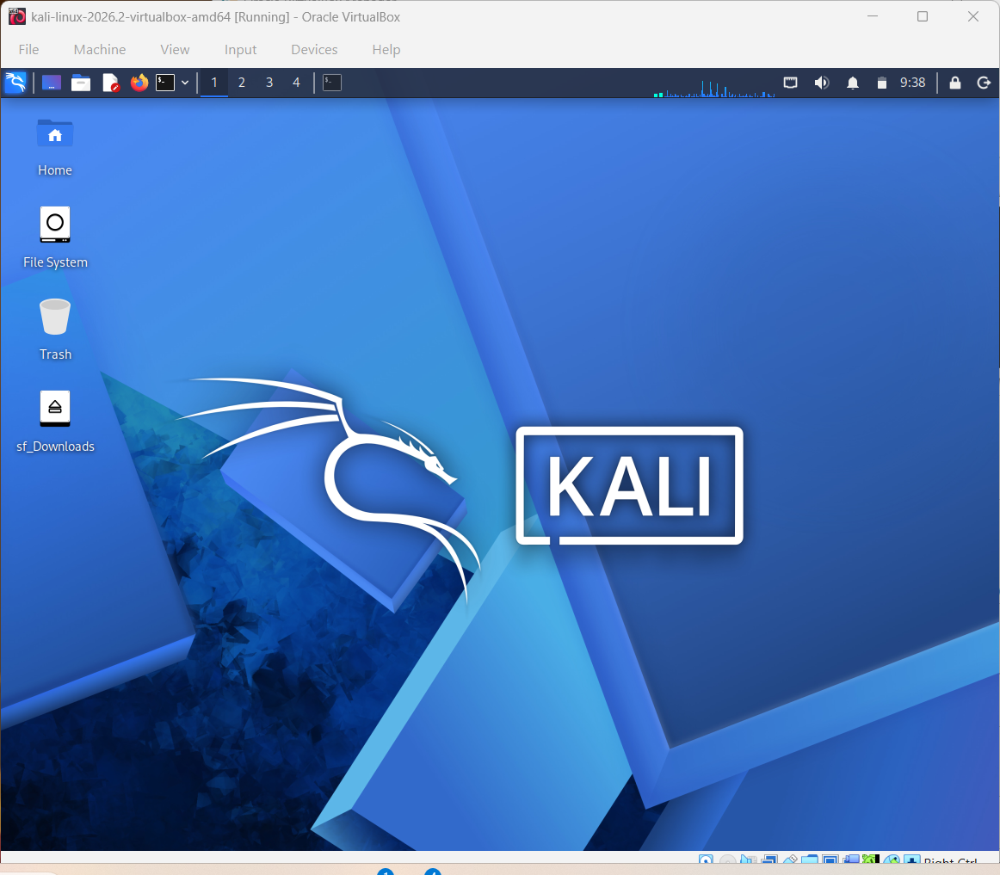

<div align="center">

# 🔐 My Cybersecurity Virtual Lab

**A practical lab setup using VirtualBox, Kali Linux, and multiple operating systems**


</div>

---

## 📌 About This Project

I am building a personal virtual lab to learn operating-system installation, virtual networking, IP configuration, connectivity testing, and snapshot recovery. I am using Oracle VirtualBox and Kali Linux as the starting point.

My lab assignment includes setting up **Windows 11, Windows 10, Windows 7, and Android 9** as separate virtual machines, connecting the machines to a suitable virtual network, testing connectivity with `ping`, and taking snapshots.


## 🎯 Project Objectives

- Configure Oracle VirtualBox for a local practice lab.
- Create and use a VirtualBox NAT Network.
- Configure Kali Linux with a consistent IPv4 address.
- Set up Windows 11, Windows 10, Windows 7, and Android 9 virtual machines.
- Test communication between the machines using `ping` where supported.
- Troubleshoot network, DNS, and shared-folder issues.
- Take a clean snapshot of each VM and another after successful network configuration.
- Record the real setup steps, test results, and screenshots as the lab progresses.

## 🏗️ Planned Lab Architecture

```text
                    My Windows Host
                          |
                    Oracle VirtualBox
                          |
              NAT Network: NatNetwork
                   10.0.0.0/24
                          |
       ┌──────────────────┼───────────────────┐
       |                  |                   |
   Kali Linux         Windows VMs          Android VM
   10.0.0.2           Planned IPs          Planned IP
   Configured          Pending             Pending
                          |
             Windows 11 / Windows 10 / Windows 7
```

The diagram shows the **planned design**, not a claim that every VM is already installed. Each VM must be attached to the same `NatNetwork` and have a unique IP address before cross-VM testing.

## ⚙️ Current Configuration

| Component | Current details | Status |
|---|---|---|
| Host operating system | Windows | In use |
| Virtualization software | Oracle VirtualBox 7.2.x | In use |
| Security/testing VM | Kali Linux 2026.2 | Running |
| Kali VM memory | 2048 MB | Configured |
| Virtual network | `NatNetwork` — NAT Network | Created |
| Network prefix | `10.0.0.0/24` | Configured |
| Kali IPv4 address | `10.0.0.2/24` | Configured |
| Gateway | `10.0.0.1` | Configured; verify reachability |
| DNS | `8.8.8.8` | Set; DNS test pending |
| Host shared folder | `/media/sf_Downloads` in Kali | Mount confirmed |
| Windows 11 VM | To be installed/configured | Pending |
| Windows 10 VM | To be installed/configured | Pending |
| Cross-VM ping tests | All required machines | Pending |
| Snapshots | Clean and network-configured snapshots | In use |

> **IP address note:** `10.0.0.2` is the current Kali address. The IP addresses for the other VMs will be assigned only after those machines are created and the selected addresses are checked for conflicts.

## 🪜 Work Completed So Far

### 1. Installed and opened Kali Linux in VirtualBox

I imported the Kali Linux 2026.2 virtual machine and confirmed that it starts in VirtualBox.

### 2. Created the NAT Network

The VirtualBox network is named `NatNetwork` and uses the `10.0.0.0/24` network prefix. The network configuration should be checked again if the virtual machines cannot communicate.

### 3. Configured Kali's static IPv4 address

The Kali network connection was configured with these values:

```text
Address:  10.0.0.2
Prefix:   24
Gateway:  10.0.0.1
DNS:      8.8.8.8
```

I confirmed that Kali has the address `10.0.0.2/24` and that a ping to `8.8.8.8` succeeded. Domain-name resolution still needs a final test.

### 4. Configured the shared Downloads folder

The shared folder is mounted at:

```text
/media/sf_Downloads
```

I ran `ls /media/sf_Downloads` and confirmed that files from the host Downloads folder are visible inside Kali Linux. Linux paths are case-sensitive, so `sf_Downloads` must use the same capital letters as the mounted folder name.

## 🧪 Verification Commands

Run these commands in Kali Linux as the lab setup continues:

```bash
# Display network interfaces and IP addresses
ip addr

# Display the routing table
ip route

# Test the NAT Network gateway
ping -c 4 10.0.0.1

# Test connectivity to an external IP address
ping -c 4 8.8.8.8

# Test DNS resolution
getent hosts google.com

# Confirm the shared folder is mounted
ls /media/sf_Downloads

# Check Nmap is installed
nmap --version
```

If the VMs use the same virtual network, test from Kali to each configured guest IP after its installation, for example:

```bash
ping -c 4 <other-vm-ip-address>
```

Replace `<other-vm-ip-address>` with the actual IP address of the target VM. Do not assume a ping failure means the network is definitely broken: the guest firewall or operating-system network settings may block ICMP echo requests. Troubleshoot the cause rather than disabling the entire firewall.

**Windows test:** In the Windows Command Prompt, use:

```cmd
ipconfig
ping <other-vm-ip-address>
```

**Android 9 test:** Once Android is installed and the network is configured, check its IP details first. Ping support and connectivity may vary by Android image and network setup.

## 📱 Android 9 — Planned Work

I have not completed the Android 9 VM setup yet. It is included in the assignment plan, and I will document it after completing the installation and tests.

Planned tasks:

1. Obtain a suitable Android 9 installation image from a trustworthy source.
2. Create a separate Android VM in VirtualBox.
3. Connect its network adapter to `NatNetwork`.
4. Configure a unique IP address after checking that it is available.
5. Test connectivity to and from the other VMs where supported.
6. Take a clean snapshot and a network-configured snapshot.

No Android installation or ping-test result is claimed in this README until it has actually been completed.

## 📸 Screenshots to Add

I will add my own screenshots as I complete each step:

 
 
 
 ![Successful gateway tests] (Successful gateway  tests.png)
 ![Network Connectivity Test] (Network Connectivity Test.png)


## 🛠️ Issues and Troubleshooting Notes

### DNS resolution

A ping to an IP address can work while a domain such as `google.com` fails to resolve. Check the DNS configuration and test with `getent hosts google.com` before recording DNS as successful.

### Shared-folder path

The shared folder name is case-sensitive. The working mount shown in my setup is `/media/sf_Downloads`, not `/media/sf_downloads`.

### Network connection settings

Before modifying a connection with `nmcli`, identify the actual connection name using:

```bash
nmcli connection show
```

Network interface names, connection names, gateways, and DNS behavior can vary with the VirtualBox network configuration. I will record the fix only after verifying it on my own VM.

## 💡 What I Am Learning

- How virtual machines use virtual network adapters.
- The difference between a regular NAT adapter and a shared NAT Network.
- How IPv4 addresses, network prefixes, gateways, and DNS work together.
- How to verify network connectivity from Linux and Windows.
- How to troubleshoot a connection instead of assuming the cause.
- How shared folders move files between the host and a VM.
- How snapshots provide recovery points before additional lab work.
- How to keep clear and honest technical documentation with commands and screenshots.

## 🔐 Responsible Use

This environment is for education and authorized testing only. I will test only virtual machines and systems that I own or have explicit permission to assess. Windows 7 and Windows 10 are older operating systems; keep them within the intended lab and avoid exposing them unnecessarily to untrusted networks.

## 🔗 Official Resources

- [Oracle VirtualBox](https://www.virtualbox.org/wiki/Downloads)
- [Kali Linux downloads](https://www.kali.org/get-kali/)

## 👤 About Me

**Rajshree ML**  
Cybersecurity learner
Program Name: Cybersecurity at Networkwalks | Week: 01 | Project: Cybersecurity & Pentesting Lab Setup | Repository: GitHub
